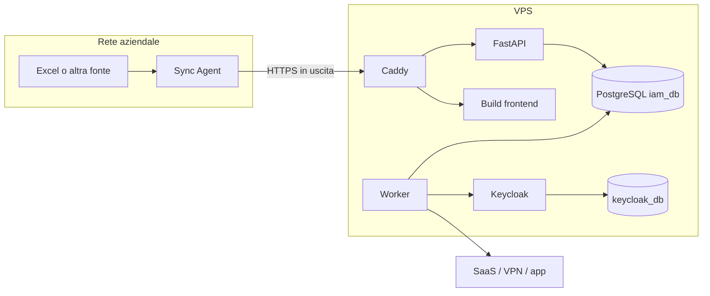

# Architettura

Panoramica sintetica. Il ragionamento completo, i rischi e il piano sono in
[docs/ANALISI_ARCHITETTURALE.md](docs/ANALISI_ARCHITETTURALE.md); le decisioni in [docs/adr/](docs/adr/README.md).

## Componenti

## Backend: modular monolith

`backend/app/`:

| Percorso | Contenuto |
|---|---|
| `main.py` | `create_app()`: engine DB, router dei moduli, `/api/health` |
| `core/` | configurazione (`ARGO_*`), logging JSON |
| `db/` | `Base` SQLAlchemy con naming convention, creazione engine |
| `modules/<nome>/` | `models`, `schemas`, `repository`, `service`, `router`, adapter |

Regole (ADR-001, ADR-017):

- Un modulo espone la sua interfaccia pubblica in `__init__.py`. Gli altri moduli
  importano solo `app.modules.<nome>`, mai i file interni.
- Le dipendenze tra moduli sono dichiarate in `backend/tests/test_module_boundaries.py`;
  il test fallisce se un import non è dichiarato.
- I router non contengono logica: chiamano il service. Le query stanno solo nel repository.
- I service non fanno commit quando partecipano a una transazione più ampia
  (es. `audit.record` scrive nella transazione del chiamante).

### Moduli presenti

| Modulo | Stato | Dipende da |
|---|---|---|
| `audit` | Scrittura append-only (`record`). | – |
| `identity` | Porta `IdentityProvider` + adapter Keycloak Admin API (ADR-021). | – |
| `sessions` | Login BFF OIDC, sessioni, `current_user`, `require_role`, `require_csrf` (ADR-022). | `audit` |
| `employees` | Anagrafica, pianificazione e applicazione delle transizioni. Non conosce fonti né IdP. | `audit`, `sessions` (router) |
| `synchronization` | Agent con chiave API, snapshot idempotenti, conferma di massa (ADR-020, ADR-023, `docs/sync-api.md`). | `audit`, `employees`, `provisioning`, `sessions` |
| `jobs` | Coda PostgreSQL generica: SKIP LOCKED, lease, backoff, idempotenza, `MANUAL_PENDING`. | – |
| `provisioning` | Run di ciclo di vita, un job per passo, handler del worker, quadro accessi. | `audit`, `employees`, `identity`, `jobs`, `sessions` |

Worker: `python -m app.worker`, stessa immagine dell'API. Esegue un job alla volta fuori
transazione e ne registra l'esito; si ferma pulito con SIGTERM.

Flusso offboarding: snapshot con `ACTIVE → INACTIVE` → `employees.apply_changes` →
`provisioning.on_changes` crea run + job **nella stessa transazione** → il worker esegue
`identity.disable`, `identity.logout`, `dashboard.revoke_sessions` → stato del run
`completed` / `in_progress` / `partial`.

Moduli pianificati e grafo delle dipendenze: analisi §4.

## Frontend

`frontend/src/`: `app/` (provider, router), `components/ui` (shadcn/ui),
`components/layout`, `features/<nome>/` (pagine, hook API, tipi della feature), `lib/`.
Ogni feature contiene le proprie chiamate API come hook TanStack Query.

Identità visiva: palette "Linea Argo" (lilla, neutri tinti, solo tema chiaro) definita
come token in `src/index.css`; contesto di prodotto in `frontend/PRODUCT.md`, direzione
della dashboard in `frontend/.impeccable/surfaces/`.

## Dati

- `iam_db`: dati IAM. Schema gestito solo da Alembic (`backend/migrations`).
- `keycloak_db`: interno a Keycloak, mai letto da FastAPI.

| Tabella | Note |
|---|---|
| `audit_events` | Append-only: trigger blocca UPDATE, DELETE, TRUNCATE |
| `user_sessions`, `login_attempts` | Sessioni dashboard (solo hash del token) |
| `employees` | Email univoca verificata a fine transazione (DEFERRABLE) |
| `sync_agents`, `sync_snapshots` | Chiavi agent (hash), snapshot con esito |
| `jobs` | Coda; indice parziale sui job eseguibili |
| `lifecycle_runs` | Un'operazione di ciclo di vita; i passi sono job con `group_id` |
