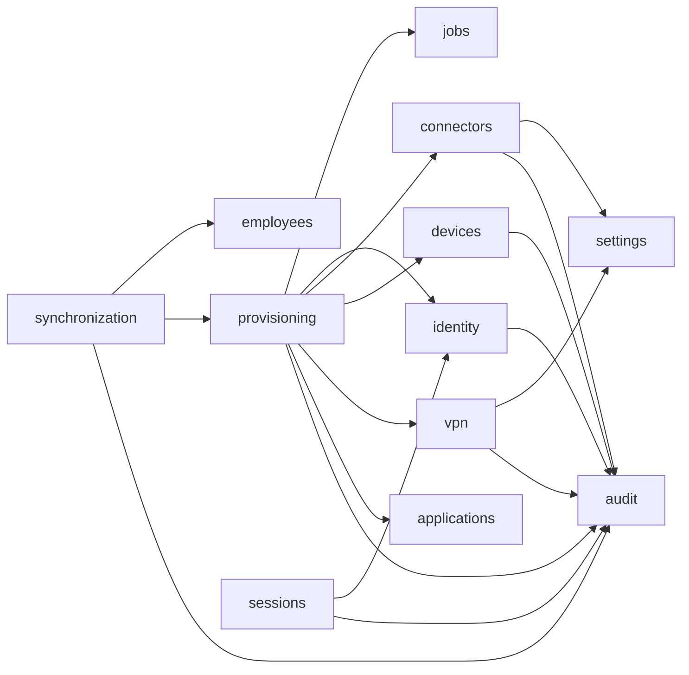

# Argo IAM – Analisi architetturale (Fase preliminare)

**Data:** 2026-11-21
**Stato:** Proposta – in attesa di approvazione. Nessun codice implementato.
**Riferimento:** "Progetto IAM – Specifica architetturale e linee guida di sviluppo" v1.0

---

## 1. Stato del repository

- `/home/mattiamare/argo` è **vuoto** e **non è un repository git**. Nessun codice, dipendenza o documentazione da preservare: nessun conflitto con implementazioni esistenti.
- Macchina di sviluppo: 2 CPU, 13 GB RAM (~6,5 GB liberi), Docker 28.5, Python 3.12.3, Node 22.
  - Vincolo pratico: Keycloak (JVM) è il servizio più pesante (~500 MB–1 GB). Va avviato solo quando serve, con heap limitato.

**Prima azione proposta:** `git init` + `.gitignore` + `.env.example` (segreti mai committati).

---

## 2. Modifiche richieste rispetto alla specifica

Due punti aggiunti da te che cambiano l'architettura:

### 2.1 Fonte dati sostituibile (Excel oggi, altro domani)

L'API **non deve sapere** che esiste Excel. Proposta:

- **Contratto API neutro:** il backend riceve *record dipendente normalizzati* con un campo `source` (es. `excel-hr`). Nessun concetto di foglio, riga o colonna nell'API.
- **Sync Agent con interfaccia `SourceReader`:** un'unica funzione `read() -> list[EmployeeRecord]`. Excel (`openpyxl`) è la prima implementazione. Un CSV, un DB del gestionale o un'API futura sono un'altra implementazione dello stesso protocollo; validazione, diff, stato locale e invio restano identici.
- **Validazione su due livelli:** il SourceReader valida il formato (colonne, tipi, duplicati); il backend valida la semantica (transizioni ammesse, employee_id noti). Il backend non si fida mai dell'agent.

### 2.2 Dashboard di setup (sviluppatore → poi titolare)

La specifica dice che il titolare non usa dashboard per l'operatività ordinaria; tu ne vuoi una per configurare il sistema e poi consegnarla. Proposta:

- Feature frontend `settings` + modulo backend `settings` per configurazioni **non segrete** (endpoint VPN, URL applicazioni, policy timeout, soglie di sicurezza del sync).
- Segreti inseriti dalla dashboard (es. token API di un SaaS) salvati **cifrati** in DB (chiave di cifratura da variabile d'ambiente, mai in DB). Mai restituiti in lettura: la UI mostra solo "impostato / non impostato".
- Due ruoli Keycloak:
  - `iam-admin`: tutto, incluso setup integrazioni (tu).
  - `iam-owner`: consultazione stato, offboarding parziali, conferme manuali (titolare).
- L'uso della dashboard da parte del titolare resta **opzionale**: il flusso Excel → revoca funziona senza che nessuno la apra.

---

## 3. Struttura definitiva delle cartelle

Monorepo, un solo `git`:

```text
argo/
├── README.md  ARCHITECTURE.md  TECH_STACK.md  DEVELOPMENT.md
├── DEPLOYMENT.md  SECURITY.md
├── docs/
│   ├── adr/                    # ADR-001…015 dalla specifica + nuovi
│   └── ANALISI_ARCHITETTURALE.md
├── backend/                    # API + worker (stesso package, due entrypoint)
│   ├── app/
│   │   ├── main.py             # FastAPI app factory
│   │   ├── core/               # config, logging, security, exceptions, permissions
│   │   ├── db/                 # engine, sessione, Base (solo infrastruttura DB condivisa)
│   │   ├── modules/
│   │   │   ├── employees/
│   │   │   ├── synchronization/
│   │   │   ├── identity/       # porta IdentityProvider + adapter Keycloak
│   │   │   ├── provisioning/   # orchestrazione offboarding/onboarding
│   │   │   ├── jobs/           # coda PostgreSQL, retry, backoff
│   │   │   ├── connectors/     # adapter SaaS (SCIM, API, manuale)
│   │   │   ├── devices/        # Fase 4
│   │   │   ├── vpn/            # Fase 5
│   │   │   ├── applications/
│   │   │   ├── sessions/       # sessione admin BFF + revoca
│   │   │   ├── settings/
│   │   │   └── audit/
│   │   └── worker/
│   │       └── runner.py       # loop di prelievo job
│   ├── migrations/             # Alembic
│   ├── tests/                  # per modulo: tests/<modulo>/
│   ├── pyproject.toml
│   └── Dockerfile
├── sync-agent/                 # progetto Python separato, nessun import dal backend
│   ├── argo_agent/
│   │   ├── sources/            # protocollo SourceReader + excel.py
│   │   ├── validation.py
│   │   ├── state.py            # ultimo snapshot confermato dal backend
│   │   ├── client.py           # httpx verso API
│   │   └── main.py
│   ├── tests/
│   └── pyproject.toml
├── frontend/                   # struttura come §11 della specifica
└── deploy/
    ├── compose.yaml            # servizi + profili
    ├── compose.prod.yaml       # override produzione
    ├── caddy/Caddyfile
    └── keycloak/realm-argo.json   # realm importabile, versionato
```

### Differenze dalla struttura della specifica (§10) e motivo

| Specifica | Proposta | Motivo |
|---|---|---|
| `infrastructure/keycloak`, `infrastructure/vpn`, … separati dai moduli | Adapter **dentro** il modulo che li possiede (`identity/keycloak_adapter.py`) | Con `infrastructure/` separata ogni modifica tocca due cartelle, e i moduli importano incrociato. Il modulo espone la porta, l'adapter vive accanto. |
| `api/router.py` centrale | Ogni modulo ha il suo `router.py`; `main.py` li monta | Un router centrale diventa il file che conosce tutto. |
| `workers/handlers/` | Gli handler stanno nel modulo che esegue l'azione e si registrano nella coda `jobs` | Il worker resta generico; la logica resta nel modulo. |
| Nessun modulo `connectors`/`settings` | Aggiunti | SaaS (§8.2) e dashboard di setup (§2.2). |

---

## 4. Moduli backend

Ogni modulo: `models.py` (SQLAlchemy), `schemas.py` (Pydantic), `repository.py` (unico punto con query), `service.py` (logica), `router.py` (solo HTTP → service). Altri moduli usano **solo** `service.py` / l'interfaccia pubblica esportata in `__init__.py`.

| Modulo | Responsabilità | Fase |
|---|---|---|
| `employees` | Anagrafica IAM, stato `ACTIVE/INACTIVE`, storico transizioni. Non conosce Keycloak. | 2 |
| `synchronization` | Endpoint per l'agent, autenticazione agent, idempotenza dei batch, validazione semantica, guardie anti-disattivazione-di-massa. Emette eventi di dominio verso `provisioning`. | 2 |
| `identity` | Porta `IdentityProvider` (crea/disabilita utente, revoca sessioni, ruoli). Adapter Keycloak via Admin REST API con service account. | 1, 3 |
| `jobs` | Tabella job, prelievo `FOR UPDATE SKIP LOCKED`, retry con backoff esponenziale + jitter, chiave di idempotenza, registro tentativi. Generico, non conosce il dominio. | 3 |
| `provisioning` | Piano di offboarding: per ogni dipendente genera l'elenco dei passi (Keycloak, sessioni, app, VPN, certificati, SaaS) come job. Calcola lo stato aggregato (completo / parziale). | 3 |
| `connectors` | Adapter SaaS: `ScimConnector`, adapter per API specifiche, `ManualConnector` (crea attività tracciata da confermare). | 5 |
| `applications` | Registro applicazioni, classificazione (OIDC/SAML/SCIM/API/manuale), metodo di revoca. | 5 |
| `sessions` | Sessione server-side della dashboard (BFF), revoca sessioni admin. | 1 |
| `devices` | Registro dispositivi, livello di fiducia, emissione/revoca certificati via step-ca. | 4 |
| `vpn` | Porta `VpnProvider` + adapter WireGuard (peer add/remove). | 5 |
| `settings` | Configurazioni non segrete + segreti cifrati delle integrazioni. | 1–2 |
| `audit` | Scrittura append-only, consultazione paginata. Usato da tutti i moduli. | 0 |

### 4.1 Dipendenze tra moduli (dirette, acicliche)



Regole:
- `employees`, `jobs`, `audit`, `settings` sono **foglie**: non importano altri moduli.
- `provisioning` è l'unico orchestratore. Nessun altro modulo chiama Keycloak per disabilitare un utente.
- Verifica automatica: test che fallisce se un modulo importa un modulo non consentito (con `import-linter`, dipendenza solo di sviluppo, oppure un test pytest di ~20 righe sugli import: preferisco il secondo).

### 4.2 Flusso di offboarding (dettaglio)

1. L'agent invia `POST /api/v1/sync/batches` con `batch_id` (UUID) e i record cambiati.
2. `synchronization`, **in una sola transazione**: verifica `batch_id` mai visto; valida ogni transizione; aggiorna `employees`; scrive audit; chiede a `provisioning` di creare i job. Job ed evento nascono insieme (nessun evento perso se il processo cade).
3. Il worker preleva i job; ogni handler è idempotente (disabilitare un utente già disabilitato = successo).
4. Stato offboarding = `COMPLETED` solo se **tutti** i passi sono `SUCCESS` (o confermati manualmente). Altrimenti `PARTIAL`, visibile in dashboard.

Stati job: quelli della specifica (`PENDING, PROCESSING, SUCCESS, FAILED, RETRYING`) più due proposti:
- `MANUAL_PENDING`: SaaS senza API, in attesa di conferma umana tracciata (§8.2 punto 4 della specifica).
- `FAILED` diventa **terminale** dopo N tentativi (es. 10 in ~24h) e genera alert; prima di allora lo stato è `RETRYING`. Va deciso cosa fa scattare l'alert (vedi §8).

Job "orfani": un job in `PROCESSING` da troppo tempo (worker morto) torna `RETRYING` tramite `locked_until`.

---

## 5. Feature frontend

| Feature | Contenuto | Fase |
|---|---|---|
| `auth` | Login via BFF, logout, guardia sulle route per ruolo | 1 |
| `dashboard` | Attivi/inattivi, ultimo sync (ok/sospeso + motivo), job in errore, offboarding parziali | 3 |
| `employees` | Tabella con ricerca/filtri/paginazione server-side, dettaglio con storico e stato offboarding | 2 |
| `synchronization` | Storico batch, batch rifiutati con motivo, stato agent (ultimo contatto) | 2 |
| `provisioning` | Coda job, retry manuale, conferma attività manuali | 3 |
| `devices` | Registro, revoca | 4 |
| `applications` | Registro e classificazione integrazioni | 5 |
| `audit` | Consultazione filtrabile | 3 |
| `settings` | Setup integrazioni, VPN, policy, chiavi agent | 1→5 |

Scelte:
- **BFF (Backend For Frontend):** il login OIDC lo fa FastAPI (code flow + PKCE, client confidential); il browser riceve solo un cookie di sessione `HttpOnly; Secure; SameSite=Lax`. Nessun token nel browser, sessione revocabile lato server. Coerente con §8.1 e §13.2. Richiede protezione CSRF sulle richieste mutanti (header custom + verifica `Origin`).
- **Tipi API generati** dallo schema OpenAPI di FastAPI (`openapi-typescript`, dev dependency): un'unica fonte di verità, niente tipi duplicati a mano.
- **Mock API:** la specifica propone Vite + mock. Propongo di **non** introdurre MSW all'inizio: backend + PostgreSQL pesano ~200 MB e danno dati reali. Si aggiunge se serve.

---

## 6. Container Docker

| Container | Immagine (versione da fissare all'implementazione) | Rete | Esposto | Profilo |
|---|---|---|---|---|
| `postgres` | `postgres:17-alpine` | `backend` | no | `db`, `app`, `prod` |
| `keycloak-db` | `postgres:17-alpine` | `idp` | no | `prod` |
| `keycloak` | `quay.io/keycloak/keycloak:26.x` | `idp`, `backend` | solo via Caddy | `idp`, `prod` |
| `api` | build `backend/` | `backend`, `edge` | solo via Caddy | `app`, `prod` |
| `worker` | stessa immagine di `api`, comando diverso | `backend` | no | `app`, `prod` |
| `frontend` | build multi-stage → file statici | `edge` | solo via Caddy | `prod` |
| `caddy` | `caddy:2.x-alpine` | `edge` | 80/443 | `prod` |

Note:
- **Frontend in produzione:** invece di un container nginx dedicato, Caddy può servire direttamente i file statici compilati (un container in meno). Propongo questo; se preferisci aderire alla tabella §4 della specifica, il container `frontend` resta.
- **In sviluppo** un solo PostgreSQL con due database (`iam_db`, `keycloak_db`) per risparmiare RAM; in produzione database separati come da specifica. Gli schemi restano comunque separati e FastAPI non ha credenziali sul DB Keycloak.
- Keycloak in sviluppo: `start-dev`, heap limitato (`JAVA_OPTS_KC_HEAP`), realm importato da `deploy/keycloak/realm-argo.json`.
- API e frontend in sviluppo girano **sul host** (uvicorn `--reload`, `vite`), non in container: più veloce e più leggero.

Combinazioni di sviluppo:

| Lavoro | Comando | RAM stimata |
|---|---|---|
| Backend senza IdP | `docker compose --profile db up` + uvicorn | ~150 MB |
| Backend + Keycloak | `--profile db --profile idp` | ~1 GB |
| Frontend | backend come sopra + `npm run dev` | +~150 MB |
| Test unit | nessun container (adapter mockati) | – |
| Test integrazione | `--profile test` (postgres tmpfs + keycloak) | ~1 GB |

---

## 7. Rischi architetturali

In ordine di impatto.

1. **Disattivazione di massa per errore umano o file corrotto.** La specifica protegge da file mancante o incompleto, ma non da un titolare che sbaglia un filtro e imposta 20 righe a INATTIVO, né da un file "valido" ma sbagliato. Proposta: soglia configurabile (es. >3 disattivazioni o >20% in un batch) → batch messo in **attesa di conferma** e alert. Questo però contraddice "il titolare non deve usare dashboard": serve una tua decisione (vedi §8).
2. **Lettura di un Excel in fase di scrittura.** Excel salva con file temporanei e lock (`~$file.xlsx`). L'agent deve: ignorare i lock file, attendere che `mtime`/dimensione siano stabili per N secondi, copiare il file e leggere la copia. Un file illeggibile → sync sospeso, mai disattivazioni.
3. **Perdita dello stato locale dell'agent.** Se l'agent perde il suo snapshot, rimanda tutto. Mitigazione: il backend è la fonte di verità sulle transizioni (confronta con il proprio stato, non con quello dell'agent) e i batch sono idempotenti. L'agent invia i record cambiati rispetto all'ultimo snapshot **confermato** dal backend; in caso di dubbio invia lo snapshot completo e il backend calcola le transizioni. Nessun rischio di doppio offboarding.
4. **Revoca non immediata nelle applicazioni custom.** Disabilitare l'utente in Keycloak non invalida token già emessi. Mitigazione: access token brevi (5 min), sessioni server-side nelle app, OIDC Back-Channel Logout (supportato da Keycloak; ogni app deve implementare l'endpoint). L'offboarding resta `PARTIAL` finché le app non confermano. **Dipende da quante app custom esistono e se puoi modificarle.**
5. **Enrollment iniziale della passkey e recovery.** Se il primo enrollment avviene tramite link email, chi controlla l'email controlla l'account. Se un dipendente perde il dispositivo e le passkey non sono sincronizzate, serve un recovery che non diventi una backdoor. Va progettato prima della Fase 1 (vedi §8). Le funzionalità passkey/recovery codes di Keycloak vanno **verificate sulla versione 26.x scelta** prima di impegnarsi: non le do per scontate.
6. **mTLS e revoca certificati.** Caddy verifica certificati client contro una CA, ma la revoca in tempo reale (CRL/OCSP) per i certificati client è da verificare. Approccio probabile: certificati a vita breve (es. 24 h) con rinnovo automatico via step-ca ("passive revocation": un certificato revocato non viene rinnovato). Implica un agent di rinnovo su ogni PC aziendale. TPM: step-ca supporta attestazione dispositivo via ACME, ma la complessità su Windows/macOS va valutata. **È la parte più costosa del progetto**: propongo di non darla per scontata nel primo rilascio.
7. **WireGuard e container API.** Nel diagramma `API → VPN`. Gestire i peer richiede privilegi di rete (`NET_ADMIN`) sull'host: non vanno dati al container API. Proposta: adapter `VpnProvider` eseguito dal **worker** verso un componente separato con privilegi minimi. Decisione rimandata alla Fase 5 (già indicata come futura).
8. **Keycloak come single point of failure.** Se Keycloak è giù nessuno accede a niente. Per 10–30 utenti accettabile con backup e restore testato, ma va scritto in SECURITY.md.
9. **Bootstrap circolare.** La dashboard usa Keycloak per il login, ma Keycloak va configurato prima. Soluzione: realm versionato e importato all'avvio + un admin iniziale creato da CLI.

---

## 8. Decisioni mancanti

Da decidere **prima della fase indicata**. Quelle con ★ bloccano la Fase 2–3.

| # | Domanda | Fase | Mia proposta |
|---|---|---|---|
| ★1 | Cosa succede con INATTIVO → ATTIVO (riassunzione)? | 2 | Riabilita l'utente Keycloak ma **non** ripristina automaticamente SaaS/VPN/dispositivi: nuovo onboarding. |
| ★2 | Onboarding: un nuovo dipendente ATTIVO nel file crea automaticamente l'account? | 2 | Sì in Keycloak + email di enrollment passkey; SaaS solo se configurato per app. |
| ★3 | Soglia anti-disattivazione-di-massa: blocco con conferma o solo alert? | 2 | Blocco sopra soglia + alert email a te e al titolare. |
| ★4 | Cambio email o nome nel file: si propaga? | 2 | Sì, su Keycloak e SaaS, perché `employee_id` resta la chiave. |
| ★5 | Come ricevi gli alert (job falliti, sync sospeso, agent silente)? | 3 | Email via SMTP (Keycloak la richiede comunque). |
| 6 | OS del server con l'Excel (Windows?) | 2 | Determina come installare l'agent (servizio Windows / systemd). |
| 7 | Autenticazione agent → API | 2 | Inizio: chiave API per agent (hash in DB, ruotabile dalla dashboard) su HTTPS. Poi mTLS con step-ca. |
| 8 | Enrollment passkey e recovery | 1 | Link monouso a scadenza breve + recovery solo tramite te con verifica di persona. |
| 9 | Microsoft 365 / Google Workspace presenti? | 5 | Cambia molto i connettori SaaS (entrambi hanno API di provisioning). |
| 10 | Elenco app custom e possibilità di modificarle | 5 | Senza questo l'obiettivo "revoca sessioni app" non è stimabile. |
| 11 | Tempo massimo di revoca accettabile | 3 | Determina frequenza dell'agent (es. ogni 60 s) e durata dei token. |
| 12 | mTLS nel primo rilascio o dopo? | 4 | Dopo: prima rilascio con passkey + BYOD policy. |
| 13 | Retention audit log | 7 | Da definire con il titolare (GDPR). |
| 14 | Provider VPS | 7 | Qualunque Ubuntu LTS con ≥2 vCPU / 4 GB RAM. |

---

### 8.1 Decisioni prese (2026-11-21)

| # | Decisione |
|---|---|
| ★1 | Riattivazione (INATTIVO → ATTIVO) ammessa, gestione semplice: l'utente Keycloak viene riabilitato e rientra nel normale provisioning, come un nuovo ingresso. |
| ★2 | Onboarding automatico: una riga nuova ATTIVO crea l'utente Keycloak e invia l'email di enrollment passkey. Policy più restrittive eventualmente in seguito. |
| ★3 | La disattivazione di massa è ammessa, ma sopra soglia il batch resta **in attesa di conferma dell'admin dalla UI**. Nessuna revoca prima della conferma. |
| ★4 | Cambi di nome/email si propagano (Keycloak e connettori), purché non comporti stravolgimenti; `employee_id` resta la chiave. |
| ★5 | Email via SMTP generico, configurabile. Sviluppo: **Mailpit** (cattura le email in locale, non le invia). Produzione: provider da scegliere (Outlook/M365 se semplice). Nota: Microsoft sta ritirando l'autenticazione basic per SMTP AUTH in Exchange Online; l'uso di Outlook potrebbe richiedere OAuth2, da verificare prima della produzione. |
| — | Confermati: Caddy serve il frontend (nessun container `frontend`), un solo PostgreSQL in sviluppo, adapter dentro i moduli. |

## 9. Piano di sviluppo incrementale

Ogni fase si chiude solo con verifica eseguibile. Rispetto alla roadmap della specifica cambio due cose: il **frontend nasce in Fase 1** (serve subito come dashboard di setup) e cresce con ogni fase invece di arrivare tutto in Fase 6; l'**audit nasce in Fase 0** perché tutti i moduli ci scrivono.

### Fase 0 – Fondamenta
- git, struttura cartelle, `pyproject.toml` (uv, Ruff, pytest), FastAPI con `/health`, config Pydantic Settings, logging JSON, SQLAlchemy async + Alembic, modulo `audit` minimo, compose con profilo `db`, scheletro frontend (Vite + Tailwind + shadcn/ui + Router + TanStack Query), documentazione iniziale e ADR.
- **Verifica:** `docker compose --profile db up` + `uvicorn` → `/health` risponde e controlla il DB; `alembic upgrade head` ok; `pytest` e `ruff check` verdi; `npm run build` ok.

### Fase 1 – Identity Provider + accesso dashboard
- Keycloak in compose (`idp`), realm versionato, ruoli `iam-admin`/`iam-owner`, login BFF, sessioni server-side, modulo `identity` (porta + adapter Keycloak: crea/disabilita utente, logout sessioni), passkey per gli admin, prima pagina `settings`.
- **Verifica:** login con passkey nella dashboard; test di integrazione che crea, disabilita e disconnette un utente su Keycloak reale; logout invalida la sessione lato server.

### Fase 2 – Ciclo di vita dipendenti + Sync Agent
- Moduli `employees`, `synchronization`; agent con `SourceReader` Excel, validazioni §5.3, stabilità file, stato locale, invio idempotente; guardia di massa (decisione ★3).
- **Verifica:** suite di test con file Excel di fixture: valido, vuoto, corrotto, colonne mancanti, ID duplicati, stato non valido, dipendente rimosso (→ nessuna disattivazione), batch ripetuto (→ nessun effetto). Dashboard mostra dipendenti e storico sync.

### Fase 3 – Provisioning e worker
- Modulo `jobs` (coda, SKIP LOCKED, backoff, idempotenza, job orfani), `provisioning` con piano di offboarding (Keycloak disable + revoca sessioni), stato aggregato, alert, pagine dashboard/provisioning/audit.
- **Verifica:** test end-to-end Excel → utente disabilitato in Keycloak; test con Keycloak irraggiungibile → `RETRYING` → successo al ritorno; due worker in parallelo non eseguono lo stesso job; riesecuzione dello stesso job = nessun effetto.

**→ A questo punto il requisito principale (§1.1 punti 1–4, 7, 8) è soddisfatto e dimostrabile.**

### Fase 4 – Dispositivi (dopo decisione #12)
Registro dispositivi, policy BYOD, step-ca, mTLS su Caddy, certificati a vita breve.

### Fase 5 – Applicazioni, SaaS, VPN
Registro e classificazione app, back-channel logout, connettori SCIM/API/manuale, WireGuard.

### Fase 6 – Rifinitura frontend
Solo completamento: le pagine nascono nelle fasi precedenti.

### Fase 7 – Hardening e produzione
Compose prod, Caddy, backup cifrati + restore test, rate limiting, monitoraggio, DEPLOYMENT.md.

---

## 10. Dipendenze previste (Fase 0–3)

Solo quelle dello stack obbligatorio più queste aggiunte, ognuna motivata:

| Dipendenza | Dove | Motivo |
|---|---|---|
| `uv` | tooling | Gestione ambiente e lockfile, molto più veloce di pip/poetry |
| `asyncpg` | backend | Driver PostgreSQL per SQLAlchemy async |
| `pydantic-settings` | backend | Configurazione da env (parte dell'ecosistema Pydantic v2) |
| `authlib` | backend | Client OIDC per il BFF (code flow + PKCE, verifica JWT). Evita di implementare OIDC a mano (§14.1) |
| `cryptography` | backend | Cifratura segreti delle integrazioni (Fernet) |
| `openpyxl`, `httpx` | sync-agent | Già nella specifica |
| `openapi-typescript` | frontend (dev) | Tipi generati dall'OpenAPI |

Nessun Redis, RabbitMQ, Celery, Kubernetes, MSW.

---

## 11. Cosa serve da te per partire

1. Approvazione (o correzioni) di struttura, moduli e piano.
2. Le decisioni ★1–★5 (servono entro la Fase 2; la Fase 0 può partire subito).
3. Conferma su: Caddy che serve il frontend al posto del container `frontend`; un solo PostgreSQL in sviluppo; adapter dentro i moduli invece di `infrastructure/`.
